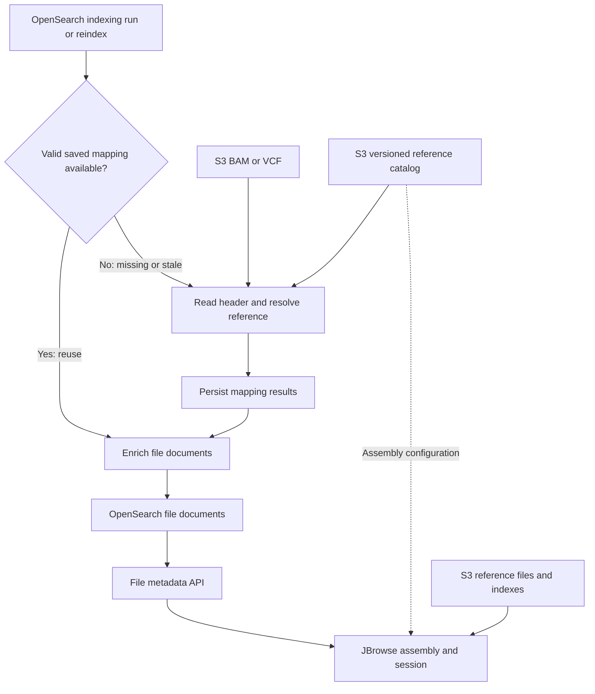
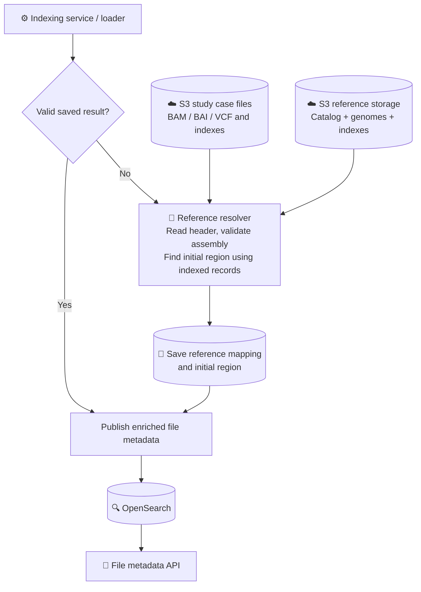

Implement reference mapping as a reusable Python enrichment step invoked by the existing OpenSearch indexing pipeline. Reuse a valid persisted mapping; otherwise inspect the remote file header, resolve and validate the reference, save the result, and enrich the file document before publication. Host the deployed reference catalog, sequence dictionaries, aliases, complete reference sequence files and matching indexes on S3. GitHub Actions is not required for the initial processing flow.

The selected flow is: indexing or reindexing starts → validate saved mapping identity/versions → reuse it or inspect the header and resolve the reference → persist new results → loader enriches the file document → publish to OpenSearch → JBrowse opens the matching assembly and appropriate initial region. The existing loader remains the sole publisher of these projected file fields.

This implementation design covers CBIIT/bento-icdc-frontend and its ingestion/indexing integration. The indexing trigger and S3 reference-hosting decisions are selected. Exact loader hooks, durable result-store location, API field names, approved S3 locations and environment configuration must be verified against the deployed services before implementation.

# Problem and evidence

The supplied frontend configuration contains six assemblies, a canFam3 reference in the default session, hardcoded initial locations, and annotation tracks carrying canFam3 data. Files can use assemblies outside that set, and compatible chromosome naming varies between distributions of an assembly.

The demo established that a local reference FASTA and matching FAI can load successfully. Header inspection supplied two useful examples:

| File | Header evidence | Meaning |
| - | - | - |
| B816 bladder organoid BAM | STAR --sjdbGTFfile names GCF_014441545.1_ROS_Cfam_1.0_genomic_PLUS_ERCC.gtf | ROS_Cfam_1.0 is an annotation-path hint; ERCC additions remain to be checked in the sequence dictionary. |
| COTC030_0202_T.bam | DRAGEN hash-table build --ht-reference names GCF_011100685.1_UU_Cfam_GSD_1.0_genomic.fna | The recorded reference FASTA is UU_Cfam_GSD_1.0; validate names and lengths against that assembly. |

An accession mentioned in a reference-building command is stronger provenance than one mentioned in a GTF filename. Neither replaces checking the file’s sequence dictionary. Loading an empty track is not evidence that no alignments exist.

These examples do not constitute the complete Production inventory. Enumerate every Production study containing BAM/VCF files, inspect at least two - five files per study where available, and record exceptions for studies with fewer files. For a per-file mapping deliverable, process every viewable file; study-level sampling alone cannot establish its assembly.

# Proposed architecture

The worker resolves references and records evidence. The catalog identifies supported references and their assets. A durable result store makes derived metadata available to both incremental indexing and full rebuilds. The existing loader owns joining those results to file documents and publishing them. The frontend obtains enriched metadata through the application API.

Invoke the resolver from the existing indexing job as an isolated per-file enrichment task with bounded resources, retry handling and a structured result. It must not run in a user-facing search or viewer request. Backfill existing files through the same indexing/reindexing path and resolver code. Package the resolver as a module or container according to the current runtime; a separately operated service or a separate workflow trigger is not required for the initial implementation.

# Execution approach

| Option | Benefit | Tradeoff | Decision |
| - | - | - | - |
| Existing indexing pipeline invokes the Python resolver | Reuses the current trigger and loader; one owner for published fields | Requires bounded per-file tasks and explicit retry/failure handling (limit 5 BAM/VCF files per study) | Selected initial implementation. |
| Separate worker runtime invoked by the indexer | Isolates resource usage and supports independent scaling | Adds a job interface and deployment component | Optional packaging choice if the current runtime needs isolation; indexing remains the trigger. |
| GitHub Actions triggers Production processing | Can support manual orchestration | Adds workflow networking, credentials and lifecycle dependencies | Deferred; not required by the initial flow. |
| Browser resolves files whenever opened | Useful for diagnosis and local-reference testing | Repeats requests and delays startup | Diagnostic/fallback tooling only. |

The implementation boundary is the indexing pipeline, not an additional user-facing service. GitHub Actions may be considered later for code release automation or administrative triggering; it is not a runtime dependency of this initial mapping flow.

# Processing stages

## 1 Register an immutable processing target

Use file UUID plus an object version or another trusted immutable content identity. Record the associated data-index identity separately. Obtain current access at execution time; do not store temporary signed URLs as the file identity.

A direct public S3 URL can be read without credentials. A worker role or a freshly obtained file-service URL can serve files that require authorization. Pin the object version when available and detect replacement during a job. An S3 ETag is useful as an object validator but must not be assumed to be a universal content MD5.

The mapping cache key includes file identity, resolver version and catalog version. Preview-region caching additionally includes index identity. Index arrival should not invalidate a completed header-only assembly assessment.

## 2 Extract the header with bounded reads

Use SAMtools/HTSlib for BAM and BCFtools/HTSlib for VCF. Header-only operations are available through samtools view -H and bcftools view -h. BAM header extraction does not require a BAI. Regional alignment retrieval does require a suitable sorted/indexed file. [SAMtools view](https://www.htslib.org/doc/samtools-view.html); [BCFtools](https://www.htslib.org/doc/bcftools.html).

Read remote bytes as a stream/ranges and stop after the complete header. S3 supports range retrieval. Enforce time, memory, response-size and aggregate-byte budgets at the worker/read layer; the -H switch alone is not a bandwidth enforcement mechanism. Do not fall back to downloading a multi-gigabyte object when a proxy ignores ranges. Measure actual bytes transferred in the pilot. [S3 GetObject](https://docs.aws.amazon.com/AmazonS3/latest/API/API_GetObject.html).

Preserve BAM @SQ names, lengths and optional AS/M5/UR/AN, plus @PG command/program lineage and @CO comments. For VCF, preserve ##reference, ##contig and applicable command metadata. Program/comment fields are text evidence: never execute recorded commands or fetch arbitrary paths from them.

Python invokes SAMtools with an argument list, for example samtools view --no-PG -H followed by the current BAM endpoint. It parses the returned header and passes structured evidence to the resolver. SAMtools does not itself assign the final assembly field or retrieve the original reference FASTA. The --no-PG option avoids adding the inspection command to the returned header; header extraction needs no BAI. Preserve signed URL arguments exactly, refresh access when needed, and avoid logging credentials. A process timeout limits runtime but is not a downloaded-byte limit.

## 3 Generate candidates and compare dictionaries

First use explicit assembly accessions/declarations and reference FASTA arguments, including DRAGEN --ht-reference. Next inspect annotation paths such as STAR --sjdbGTFfile as weaker hints. Command history may include multiple assemblies or previous processing steps; keep the evidence source and do not select the last occurrence.

When needed, discover candidate assemblies from versioned sequence accessions using NCBI metadata, then cache the returned assembly dictionaries. For simple names such as 1 or chr1, use the curated catalog or supplied metadata; those names do not identify an assembly globally. NCBI discovery is not restricted to the six assemblies currently configured in JBrowse. [NCBI Datasets API definition](https://raw.githubusercontent.com/ncbi/datasets/master/datasets.openapi.yaml).

Compare the full available names/lengths and usable sequence checksums with each candidate. Use only verified assembly-specific aliases, preserving accession versions. A name/length dictionary match establishes compatibility, not independent proof of reference-base identity.

Represent exact dictionary match, compatible subset, compatible base assembly with extras, metadata hint, ambiguous, conflict and unresolved separately. Generic VCF contig dictionaries may be incomplete. Do not promote a single shared mitochondrial sequence or a partial match to a definitive assembly identification. Explicit metadata versus dictionary disagreement requires review.

For ERCC, decoys and custom additions, retain a reference-composition identifier and the extra sequences. Do not silently drop them to claim an exact match to the base assembly.

## 4 Establish browser support and preview region independently

After resolving identity, check whether compatible reference assets and aliases are available. Identified-but-unconfigured and temporarily-unavailable assets are different outcomes from an unknown assembly.

If a usable BAI/CSI or TBI/CSI is available, use it to locate candidate data blocks and inspect a small bounded number of actual records. Choose a covered reference contig and a window containing a visible alignment or variant, limited by contig bounds. Apply the viewer’s default visibility filters. For spliced reads, anchor the preview in an aligned block rather than an intron.

Store the actual-record location as the preferred initial region. A first-contig default remains a fallback and must be labeled as not confirmed to contain data. A bounded search finding no records must not be described as proof that the entire file is empty.

If no index exists, finish reference mapping and leave preview status as index_missing. If the search exceeds its budget, record search_incomplete. Neither condition changes the assembly identity.

# Reference catalog and asset hosting

## S3 publishing and browser access

Reference genomes and their matching indexes will be hosted on S3. A versioned reference catalog will map each supported assembly and reference distribution to its sequence names and lengths, asset URLs, and JBrowse configuration.

Before publishing a reference, verify that its files and indexes match and that JBrowse can access them. Reference assets will use stable, versioned locations so existing mappings continue to resolve consistently.

# Result contract and persistence

Save each file’s reference mapping in persistent storage. Repeat detection only when the file or relevant detection rules change. Store detailed evidence separately, and publish only the reference mapping and initial-region summary to OpenSearch.

| Result | Proposed content | Description |
| - | - | - |
| Target | study_id, file_uuid, file_name, data version/checksum if available, BAM index UUID (initial region) or stable identity | Identifies the sampled BAM and its matching BAI/CSI index. The index supports efficient retrieval of reads to find an initial region containing data. |
| Resolution | candidate/resolved assembly_id, reference_variant_id, resolution_status, evidence_method | Records the candidate or identified reference, any custom composition, the resolution status and how it was determined. |
| Validation | matched/unmatched/extra contig counts, conflicts, catalog dictionary version, checksum coverage | Summarizes how well sequence names, lengths and available checksums match the reference, including missing or extra sequences and conflicts. |
| Evidence | evidence record locator, raw-header hash, reviewed override provenance | Links to supporting header evidence and records the provenance of any reviewed manual correction. |
| Browser support | catalog entry/config version, supported contig coverage, configured/unconfigured/unavailable status | Records whether compatible reference assets and JBrowse configuration are available and which sequences they cover. |
| Initial region | contig/start/end, coordinate convention, observed_record or reference_default, discovery status | Specifies where JBrowse opens and whether the location contains an observed read/variant or is a reference default. |
| Processing | resolver/catalog/schema versions, inspected timestamp, retryable failure reason | Records inspection time, software/catalog/schema versions and failure information used to decide whether to retry. |

## Proposed file metadata fields

A BAM can contain many reference sequences. Its chromosome/contig names belong in the evidence dictionary; the field selecting JBrowse’s genome should identify the reference assembly. Do not store a single chromosome accession as though it were the complete assembly.

| Proposed field | Purpose |
| - | - |
| reference_assembly_id | Canonical assembly accession/version, populated only when the resolution policy accepts the result; keep candidates separately. |
| reference_variant_id | Exact reference composition/distribution, including verified ERCC/decoy additions or renaming. |
| reference_mapping_status | Explicit resolution status such as exact_dictionary_match, metadata_hint, ambiguous, conflict, or unresolved. |
| reference_catalog_id | Immutable catalog entry/release reference used to build the JBrowse assembly configuration. |
| initial_region | Separate contig/start/end object with provenance and discovery status; it does not establish assembly identity. |

These are proposed API/search enrichment names, corresponding to the result groups above. Confirm naming and ownership with the existing loader/API. Any adoption as official scientific data-model properties follows the established data-model update process.

Prefer an explicit region object with a documented convention; for example, store 0-based half-open coordinates internally and convert to the existing frontend’s 1-based inclusive locus string at one defined boundary.

Differentiate these independent statuses:

- Resolution: exact_dictionary_match, compatible_subset, base_with_extras, metadata_hint, ambiguous, conflict, unresolved.

- Browser support: configured, unconfigured, assets_unavailable, partial_reference_coverage.

- Preview: record_found, index_missing, search_incomplete, reference_default, retrieval_error.

Eligibility for automatic opening is a policy decision. Initial default: allow a unique validated dictionary match or a reviewed compatibility decision, plus compatible available browser assets. A metadata filename hint alone is shown as a candidate, not silently accepted.

Use explicit keyword/object mappings for the enrichment summary. Do not dynamically create OpenSearch fields from chromosome names, program tags or full raw headers. If a proposed field becomes part of the official ICDC scientific data model, follow its existing model update process. A derived search enrichment does not itself authorize a model change.

## Reference mapping and index loading

The existing indexing service reuses valid saved reference mappings. When inspection is needed, a Python resolver reads the remote file header, validates the reference, and uses indexed records to find an initial region.

# JBrowse startup behavior

The file API should supply the mapping summary and catalog reference with the current data/index URLs. At open time the frontend:

1. Checks resolution and browser support; loads the exact catalog version/configuration.

2. Creates the selected assembly and appropriate per-file tracks, with assemblyNames restricted to their compatible reference.

3. Uses a confirmed-record preview when available, otherwise a valid catalog/reference default clearly labeled as not confirmed to contain data.

4. Offers clear resolution/retrieval/support errors instead of silently opening canFam3.

5. Offers a diagnostic/local-reference path where appropriate, without silently promoting a user choice into global Production metadata.

Selecting compatible chromosome aliases does not change genomic coordinates between assemblies. Do not use chr stripping or a shared track tag as a substitute for assembly matching.

The provided NCBI, Ensembl and human-to-canine annotation tracks contain canFam3 data. Restrict them to that supported assembly. No non-canFam3 annotation expansion or implicit liftover is part of this work.

For multiple selected files, group by compatible reference-distribution identity and create separate tabs/views for different references. Files within the same assembly may use verified naming aliases. Files with custom additions need an explicit coverage policy; opening supported chromosomes does not imply the reference covers ERCC/decoy sequences. One group preview can leave other sparse tracks empty, so retain a per-file Jump to data action.

## Resolver deployment and dependency security

- **Deployment:** SAMtools, BCFtools and HTSlib can run in the existing index-loading service; a separate service is not required.

- **Dependency inventory:** Include Python packages, compression/TLS libraries and container OS packages. Verify the actual bundled or linked HTSlib version.

- **Known vulnerabilities:** Scan application dependencies and the deployed image for CVEs and security advisories. Confirm affected versions and processing paths before recording a finding.

- **Patching:** Use patched, pinned dependency versions and review scan findings before release.

- **Permissions and isolation:** Run without elevated privileges and restrict file/network access. If the loader holds broad Production credentials, prefer a restricted resolver task/container; this adds deployment configuration but isolates parsing and resource usage.

- **Resource limits:** Enforce time, memory, downloaded-byte and decompressed-byte limits.

- **Command safety:** Invoke tools with argument lists and never execute commands found in headers.

- **Credential protection:** Redact signed URLs and credentials from logs.

- **Publication ownership:** Keep the existing loader responsible for publishing enriched metadata to OpenSearch.